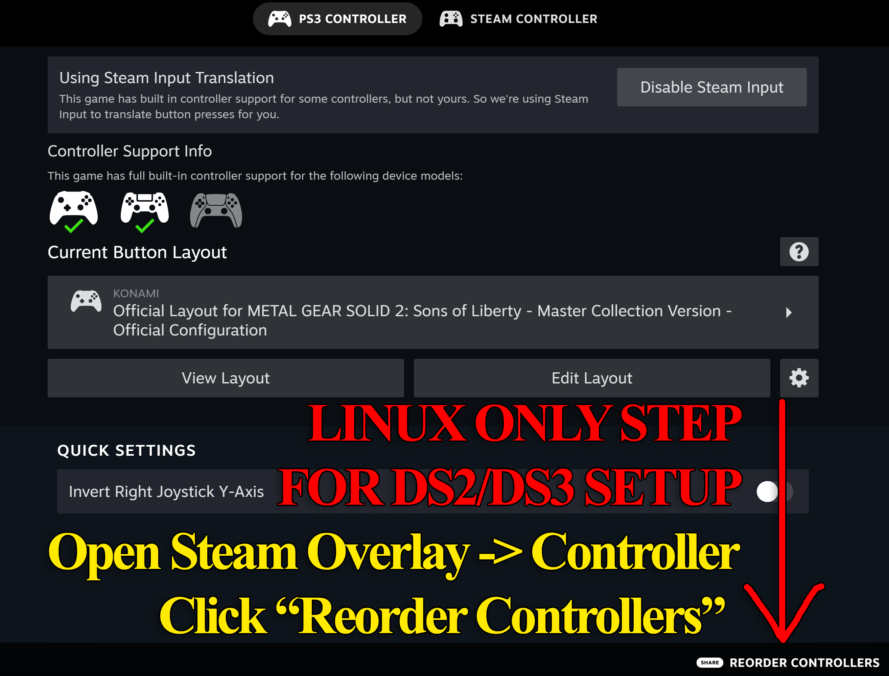
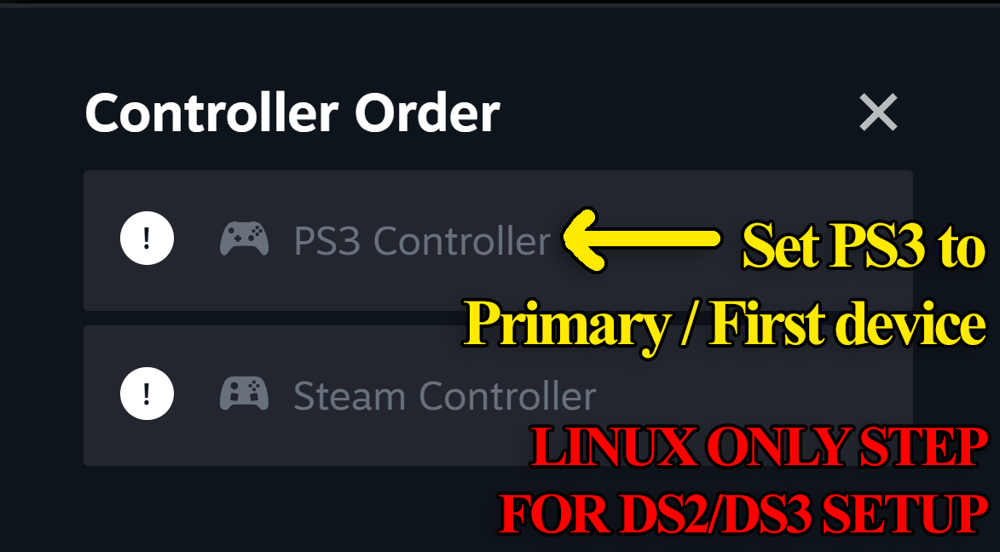
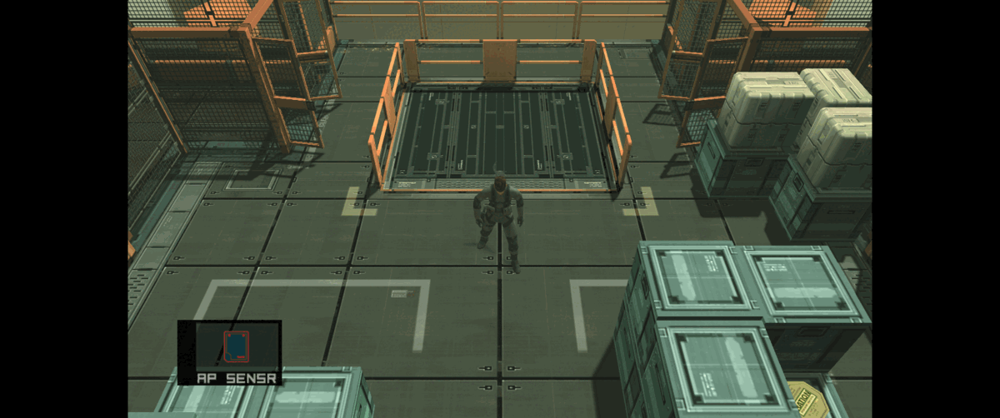
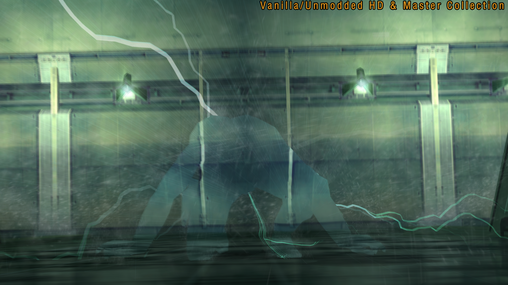
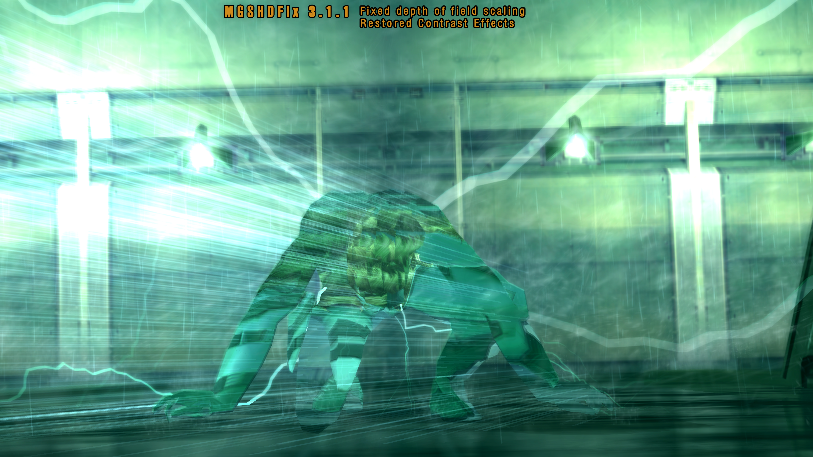

# MGSHDFix: Restoring Iconic Visuals & Stability for Metal Gear Solid Master Collection 🎮

### 📦 PowerShell Install Button

  

---

Some games ship with their best tricks cut, and the Master Collection is no exception—broken visual effects, crashes that shouldn't exist, and stock resolutions that flatten the whole experience. MGSHDFix exists to put those pieces back where they belong, restoring the effects that got lost in the shuffle while fixing vanilla crashes that would otherwise drag you straight out of the mission. Custom resolutions land alongside a pile of other tweaks and fixes, all tuned for the tinkerers who like their stealth with a little extra polish and their codebase open for tinkering.

## ✅ Requirements

- **PowerShell 5.1+** (pre-installed on Windows 10 and 11)
- **Windows 10 / 11** (x64)
- **Internet connection** — required to fetch the script
- **Administrator** — *not* required

## Features

- Custom resolution and ultrawide support across all supported titles, so the game finally fills the screen you actually own.
- Borderless and windowed modes for painless alt-tabbing between codec calls and your browser.
- Experimental 16:9 HUD option that resizes HUD elements and movies (MGS2/MGS3).
- DualShock 2 / DualShock 3 support, including pressure-sensitive face buttons for the purists.
- X/O swap option for menus, because muscle memory is sacred.
- Mouse cursor toggle, launcher skips, and an option to disable pausing on alt-tab.
- Bilinear texture filtering toggle for that crisp pixel-art look, plus adjustable anisotropic filtering (MGS2/MGS3).
- Increased texture size limits (MG1/MG2/MGS3), PS2 controller glyph support without overwriting existing textures, and SMAA anti-aliasing (MGS2/MGS3).
- Gamma correction that restores CRT-era vibrancy and deeper blacks.
- A speedrunner in-game timer and statistics overlay, plus an option to disable Steam Achievement unlocking for clean runs.
- Translation file loading: drop a dif.json translation into the game's translations folder to replace all .SDT & .GCX text without touching game files.

**MG / MG2 extras**

- Custom developer menu with stage select and item/equipment modification.
- Options to disable cigarette health drain, crop overscan borders, and correct the aspect ratio to 4:3.
- `.flac`, `.wav`, `.mp3`, and `.ogg` audio replacement support.
- Vector .ttf text replacement for the game's low-res text, with Latin and non-Japanese font support available on request.
- Auto-checking inventory for keycards at doors, restored original MSX2 boss names, and a retranslated MSX2 script option (English for now, translators welcome).
- MG2 sprite restorations, censored content reverts, and fixes for the in-game timer not pausing in menus.

**MGS2 extras**

- Bluepoint's cancelled Subsistence-style third-person camera and cancelled first-person shooter camera, unlocked.
- Restored 2001 Japanese Sons of Liberty ringtone, original radar rotation, and PS2 Solidus choking behavior.
- Sunglasses forcing, RTC hostage easter egg, grenade cooking, and the classic elevator glitch for old strat practice.
- Real-time thermal palette swapping on the numpad, high-frequency blade anywhere, and cut MG2 Colonel sprites during late-game Codec calls.
- Shadow resolution that scales dynamically with game resolution, shell casings rendered at all distances, and radar in Snake Tales.
- Custom lifebar names, including auto-reflecting the current character like later entries.
- Non-lethal punches against Vamp, highest-quality NPC models forced on, and load-time prefetching with preload-only and full modes (full mode adjusts IGT honestly).
- Skippable Olga taunt, Stillman tutorial, sword training, and ending with correctly adjusted IGT.
- BP_Asset / Manifest modloader support for the tinkerers.

**MGS3 extras**

- Grass rendered at all distances, because the jungle should actually be a jungle.
- Mouse sensitivity adjustment for finer aim control.

And that's before we get into the bug fixes — broken visual effects, vanilla crashes, and a pile of regressions from the HD era have all been hunted down. More features and fixes land frequently, so treat this list as a living document rather than a final word.

## Installation

Getting MGSHDFix into your game is the easy part — the hard part is deciding which of its many toggles to enable first. Here's how to get it running cleanly.

1. **Start with a vanilla copy of the game.** If you've already tinkered with the Master Collection (previous fixes, loose-file swaps, altered archives), roll those changes back first. Layering this fix on top of another patch is the fastest way to summon the exact crashes it was built to banish.

2. **Grab the latest release** for MGSHDFix. Steam users should have the Master Collection installed and launched at least once so its directories exist. Keep the game closed while you work — the files you're about to add won't take kindly to being written while the engine has them open.

3. **Drop the fix into each game's folder.** Because the Master Collection ships MG1/MG2, MGS2, and MGS3 as separate programs, you'll install the fix into each game's own directory rather than a single shared location. Follow the bundled readme for the exact folder layout — when in doubt, the files belong right alongside the game executable.

4. **Launch once, then configure.** The first run generates the fix's configuration file. From there, open the config tool (or edit the file directly, if you're the tinkering type) to dial in your resolution, HUD scaling, controller glyphs, camera options, and all the rest. Every feature is opt-in — the fix won't rearrange your setup unless you ask it to.

5. **Keep it updated like a mod, not a patch.** When a new release lands, replace the old files wholesale rather than merging them; stale leftovers from a previous version are a common source of weird behavior.

**A few field notes from the trenches:**

- Make a backup of your save data before your first launch with the fix active. It's almost certainly fine, but "almost certainly" is a phrase no modder should say twice about a save file.
- If you *do* hit a crash or a visual oddity, disable features one at a time to isolate the culprit — most issues trace back to a single toggle interacting badly with a specific game or GPU driver.
- Speedrunners and tinkerers should note that certain fixes (load-time optimizations, timer behavior) can affect in-game time or vanilla behavior by design. Read the relevant config descriptions before flipping those switches.
- Windows, Linux/Steam Deck, and multi-GPU laptop setups are all covered — but if the game insists on using the wrong GPU, the fix includes options to sort that out, so don't fight your drivers alone.

Once you're in, you'll wonder how you ever played without it. Enjoy the restored effects, the custom resolutions, and the distinct lack of vanilla crashes.

## Compatibility

MGSHDFix is built to play nice with the rest of your modding setup, not to fight it for control of the game. It patches the Metal Gear Solid Master Collection executables directly at runtime, so it happily coexists alongside texture packs, audio restorations, translation mods, and asset loaders that use supported manifest or BP_Asset methods. If a mod already replaces a file MGSHDFix touches, the fix stays out of the way and lets your mod win — no silent overwrites of your carefully curated load order.

A few things worth knowing before you stack mods:

- **Translation and text replacements**: MGSHDFix loads its own translation file from a dedicated folder per game, so language mods can slot in without touching the game's original files. If you're building a translation, this is the friendliest path — no need to repack archives.
- **Restored audio mods**: Several audio fixes (looping tracks, missing music variants) rely on an accompanying restored audio mod being present. If you skip it, the fix simply doesn't activate — no crashes, just silence where silence shouldn't be.
- **Community bugfix compilations**: A handful of restoration fixes (title screen color swaps, cutscene texture corrections) expect a community bugfix compilation to be installed. Again, missing companions mean the individual fix is skipped cleanly.
- **Speedrunner toggles**: Some anti-alt-tab and load-optimization fixes ship with opt-out switches in the config, precisely so runners can preserve vanilla behavior when practicing old strats. Toggle them per your route.
- **Loader conflicts**: If you use a separate asset or manifest modloader, MGSHDFix's own loader support is designed to layer, not override. Load order matters — if something looks off, check which loader is grabbing the file first.
- **Version drift**: The Master Collection receives official patches occasionally. MGSHDFix tracks those, but if you're on an older game build, check the release notes — a fix compiled for a newer build may refuse to inject rather than risk corrupting your install.

In short: bring your mods, bring your translations, bring your speedrun hacks. MGSHDFix plays well with others, steps aside when it should, and keeps its hands off your files unless you ask it to. If something misbehaves in a stack, the config tool and nightly builds are the first places to look — and the community is usually a message away.

## 📸 Screenshot

## Credits

This fix exists because a lot of people refused to accept that the Master Collection should ship with broken bloom, missing post-processing, and crashes that nobody asked for. The following folks made sure it didn't stay that way.

**The Usual Suspects**
The core of this project is a one-man army who somehow finds time to reverse-engineer rendering pipelines, chase down engine-level regressions, and still answer issue tickets. If this fix saved your playthrough, that's who you have to thank. Extra salutes go to the contributors who've submitted pull requests, reported crashes with actual repro steps, and generally made the codebase less of a minefield.

**The Bug Hunters**
Every typo caught, every broken cutscene reported, every "hey, this effect looks nothing like the PS2 version" screenshot is worth its weight in rations. Playtesters and speedrunners who stress-tested the thing until it broke — and then told us exactly how it broke — deserve a Codec call of gratitude. Special nod to the folks digging through the original releases frame by frame so the rest of us could see what was actually lost.

**The Translators & Tinkerers**
To everyone building translation files, poking at the custom fonts, or asking for their language to be supported: you're the reason the text replacement system exists at all. Keep the requests coming.

**The Community**
The Metal Gear modding scene has always been a strange, wonderful, slightly obsessive bunch, and this project would be a lot lonelier without it. Whether you're here to restore a censored flash, practice an old elevator glitch, or just play the games the way they were meant to look — welcome aboard. Keep the reports coming, keep the screenshots honest, and don't forget to save often.

**And You**
Yes, you — the one reading this at 3 AM because something in the codec scene looked wrong. Thanks for caring enough to notice. Snake would approve.

## License

MGSHDFix is released under the MIT license. You are free to use, modify, and distribute this fix as you see fit — whether you're tinkering with it for personal use, folding pieces of it into your own project, or building something bigger on top of it. All we ask is that you keep the copyright notice and license text intact, and that you don't hold us liable if something goes sideways. Metal Gear is a franchise built on sneaking around, but there's no need to be sneaky about this: read the license, understand it, and go make something cool.

If you're incorporating portions of MGSHDFix into your own mod or project, a credit and a nod back to the project is always appreciated, even if the license doesn't demand it. The modding scene runs on mutual respect and shared work, and we're proud to be part of it. Pull requests, bug reports, and feature suggestions are welcome — every contribution helps keep the project alive and evolving.

One important note: MGSHDFix is a fan-made project and is not affiliated with or endorsed by Konami or the developers of the Metal Gear Solid Master Collection. All game assets, characters, and trademarks remain the property of their respective owners. This fix exists solely to improve the experience of playing the games you already own, and should never be treated as a replacement for a legitimate copy. Support the official release — that's what keeps the series alive.

So go forth, enjoy the enhanced visuals, the restored effects, the custom resolutions, and all the small refinements that make each playthrough a little sharper. And if you wind up modifying the fix for your own purposes, remember that the best modders are the ones who share what they learn. Godspeed, operative.